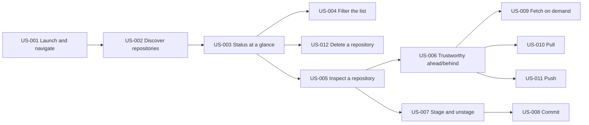

# git-station v1 Backlog

## Summary

git-station (`gs`) is a keyboard-driven TUI to discover, monitor, and manage every local git repository on the machine from one place, including everyday write operations (stage, commit, fetch, pull, push) without leaving the terminal. The backlog covers v1 only, as specified in [SPECS.md](./SPECS.md). Priorities use MoSCoW. There are 5 epics and 12 stories (11 Must, 1 Could), ordered to match the spec's milestones M1–M7. This file is also the progress tracker: every acceptance criterion is a checkbox, and the table below is the at-a-glance state.

## Status

| Story   | Title                                        | Status      |
| ------- | -------------------------------------------- | ----------- |
| US-001  | Launch gs and move between its two views     | Done        |
| US-002  | Discover every repository on the machine     | Done        |
| IMP-001 | Simplify the directory walk in src/repo.ts   | Done        |
| IMP-002 | Ship a Linux binary with a one-line install  | Not started |
| IMP-004 | Tighten the status naming and path reading   | Done        |
| US-003  | See the state of each repository at a glance | Done        |
| US-004  | Filter the list by name                      | Not started |
| US-005  | Inspect one repository in detail             | Done        |
| US-006  | Trust the ahead/behind I see                 | Not started |
| US-007  | Stage and unstage files                      | Not started |
| US-008  | Commit the staged changes                    | Not started |
| US-009  | Fetch the open repository on demand          | Not started |
| US-010  | Pull from upstream                           | Not started |
| US-011  | Push to upstream                             | Not started |
| US-012  | Delete a repository from the list            | Not started |

Tracking rules:

- Tick a step only when it has been verified — by running the app, running the tests, or checking from another terminal — not when the code is merely written. A step marked `eye` counts as verified when the user says he looked at it and it is right.
- Move a story to **In progress** when you start it, and to **Done** when every criterion is ticked.
- The unit of work is the next unticked step. If a criterion is too big for one sitting (more than one thing to check at the end), the agent splits it into indented sub-steps right under it, writing them into the backlog file at that moment. Once written they are the plan: a later conversation uses them as they are and never splits the same criterion again, unless the user asks or the scope changes. Each sub-step is ticked on its own, and the parent criterion is ticked when all its sub-steps are.
- Each step being worked on carries a `Verified by:` line: a test file with test names and `planned` or `written`, or `eye` for what the screen shows. The line is added when the step is planned, not for the whole backlog in advance. A step that already has the line never gets new tests proposed; `planned` means the tests are still to be written.
- When the last step of a story is done, the agent writes `Closing questions: pending` under the story's heading. It becomes `done` once the user has answered the explanation and chosen from the proposals (or said none).
- At the end of a story the agent offers a numbered list of proposals (names, refactors, automations). The ones the user picks are added to the backlog as improvements: `IMP-001`, `IMP-002`… They appear in the Status table and in an `## Improvements` section at the end of the file, with the same checkboxes, sub-steps and `Verified by` lines as stories, and they go before the next story's first step unless the user says otherwise.
- This is the single progress tracker; SPECS.md stays spec-only.

## Assumptions and open questions

- Assumption: single user on a single Linux machine; the persona is the developer himself (solo project, built by hand).
- Assumption: the bun + opentui scaffold already exists (dependencies pinned, lint/format configured), so there is no project-setup story; US-001 is the walking skeleton.
- Assumption: stories reference keys from the draft keyboard map in SPECS.md; key names may change during implementation without changing the stories' value.
- Assumption: criteria that say "an external `git status` / `git log` confirms" are verified from a second terminal — git itself is the oracle, since gs wraps it.
- Assumption: ahead/behind shown anywhere reflects local refs (last fetched state); only US-006 introduces network.
- Resolved: the binary will be named `git-station`, not `gs` — the ghostscript collision on `/usr/bin/gs` is avoided entirely. The `bin` entry in package.json should use that name.
- Open question: US-004 (filter) is Could — confirm whether it ships in v1 or moves to v2.

## Out of scope

Everything in SPECS.md §Non-goals: interactive rebase, stash management, submodules, pull requests / platform integrations, remote-hosted repositories, merge conflict resolution UI, applying one action to many repos at once (including fetch-all). Also out: commit history log, per-file diff, and branch checkout views (v2 candidates), and a discovery cache.

## Suggested order

Follows the spec's milestones; after each milestone the app is demonstrable.

1. **M1 Base TUI**: US-001
2. **M2 Discovery**: US-002
3. **M3 Status**: US-003, then US-004 (optional polish)
4. **M7 Delete**: US-012 (needs only the interactive list; place after M3)
5. **M4 Detail read-only**: US-005, US-006
6. **M5 Stage + commit**: US-007, US-008
7. **M6 Network ops**: US-009, US-010, US-011

## Epic E1: See every repository at a glance

Open `gs` from any directory and read the state of every repository on the machine in one screen.

### US-001: Launch gs and move between its two views

**Epic:** E1 · **Priority:** Must · **Size:** S · **Depends on:** none

**Story**
As a developer with many local repositories, I want to launch `gs` from any directory and move between the list and the detail view with the keyboard, so that getting in and out of the tool is instant and never leaves my terminal broken.

**Acceptance criteria**

- [x] Given a terminal open in any directory, when I run the app, then a full-screen list placeholder renders with the key hints visible.
- [x] Given the list placeholder, when I press Enter, then the detail placeholder renders; when I then press Esc, then the list placeholder is back.
- [x] Given any view, when I press q or Ctrl+C, then the process exits and the shell prompt returns with the terminal fully usable (no escape-code garbage).
- [x] Given the app running, when I resize the terminal window, then the view re-renders to the new size without crashing.
- [x] Given the project's package.json, it declares a `git-station` bin entry pointing at the entry file.
- [x] Given the repo, when I run typecheck, lint, and format check, then all three pass.

**Out of scope**

- Real repository data, discovery, and git operations.

**Notes / open questions**

- Walking skeleton: absorbs bootstrap, renderer lifecycle, view switching, and the `bin` field (SPECS.md M1). Placeholders are static text naming the view plus key hints.

### US-002: Discover every repository on the machine

**Epic:** E1 · **Priority:** Must · **Size:** M · **Depends on:** US-001

Closing questions: done

**Story**
As a developer with repositories scattered across my home directory, I want `gs` to find them all by itself when it opens, so that I never have to register repositories by hand.

**Acceptance criteria**

- [x] Given `$HOME` contains repositories (including nested ones and at least one git worktree), when the app opens, then every one of them appears in the list, including the worktree.
- [x] Given heavy directories (node_modules, .cache, virtualenvs) exist under `$HOME`, when the scan runs, then they are skipped.
- [x] Given a config file declaring an extra root and an ignore entry, when the app opens, then repositories under the extra root are listed and ignored paths are not.
- [x] Given no config file exists, when the app opens, then the scan still runs with defaults and no error is shown.
- [x] Given a scan in progress, then an animated progress bar (no percentage) with a "found: N" counter is visible, and the counter climbs while the walk runs.
- [x] Given a scan that finishes, then the bar fills completely and the full list renders.

  Verified by: eye

  Decision (2026-11-11): the list no longer fills incrementally — the user chose a progress bar + list at the end; SPECS.md §Discovery reflects it.

- [x] Given a fixture with no repositories at all, when the scan finishes, then an empty state with a hint renders instead of a blank screen.

  Verified by: eye (chosen 2026-11-11: dedicated `EmptyState` component)

**Notes / open questions**

- SPECS.md §Discovery (D1): prune list, config format, and `.git` as a file counting as a repository. Walker mechanics are unit-tested with temporary fixtures.
- Decision (2026-11-10): repositories are reported at any depth. The old "do not descend into a repository once found" rule hid real repos — loose clones gitignored by their parent (the vivarium case: vivarium-core, vivarium-ui would never appear).

### US-003: See the state of each repository at a glance

**Epic:** E1 · **Priority:** Must · **Size:** M · **Depends on:** US-002

Closing questions: done

**Story**
As a developer scanning many repositories, I want each row to show the branch, a dirty indicator, and ahead/behind versus upstream, so that I can tell which repositories need attention without opening them.

**Acceptance criteria**

- [x] Given a repository with a dirty working tree, 2 commits ahead and 1 behind its upstream (per local refs), when the list renders, then its row shows the name, the branch, a dirty mark, and ahead 2 / behind 1.
  - [x] Given one repository, when its status is read, then the branch line yields the branch name and ahead/behind, and yields `detached` and `—` when there is a detached HEAD or no upstream.

    Verified by: src/status.test.ts — `parseStatus` → 'reports the branch and ahead/behind from the status header', 'reports detached and no upstream with no ahead/behind' (written)

  - [x] Given one repository, when its status is read while it has an unstaged change, then the repository comes back marked dirty; a clean one is not.

    Verified by: src/status.test.ts — `parseStatus` → dirty flags from file entries, clean without (written)

  - [x] Given the list of repositories, when it renders, then every row shows the name, the branch, the dirty mark and ahead/behind.

    Verified by: eye (2026-11-13: centered table, widths as percentages of the table box)

- [x] Given a repository in detached HEAD, when the list renders, then the branch column shows `detached` and ahead/behind show `—`.

  Verified by: eye (written 2026-11-14)
- [x] Given a repository with no upstream configured, when the list renders, then ahead/behind show `—` and no error is displayed.

  Verified by: eye (written 2026-11-14)
- [x] Given many repositories, when the app opens, then each repository's status starts being read as soon as the walk finds it, and the list renders complete once the last status arrives — the loading screen stays until then.

  Decision (2026-11-14): the list never shows half-filled rows. Overlapping the status reads with the walk is the only change; the UI stays on the loading screen until every status is in. SPECS.md M3 updated to match.

  Verified by: eye (written 2026-11-14). Measured with `scan()` on this machine: 23 repos, 23 statuses, first repo announced 15 ms after start, total 562 ms against 659 ms for the old scan-then-read sequence. Walk mechanics stay covered by `src/repo.test.ts`; `scan` itself is thin orchestration over `findRepos` + `readStatus`, both already covered.
- [x] Given a repository where git itself fails, when its status cannot be read, then the row renders with an error marker and the app keeps running.
  - [x] `readStatus` rejects with git's stderr when its exit code is nonzero (e.g. a directory that is not a git repository).
    Verified by: `src/status.test.ts` — `readStatus` → 'throws the git error message when git fails' (written)
  - [x] `scan` switches to `Promise.allSettled` and returns the repositories in order plus two maps: path → status for readable ones, path → error message for broken ones; an unreadable directory does not lose its siblings.
    Verified by: `src/status.test.ts` — `scan` → an unreadable directory does not break the listing (written); walk mechanics stay covered by `src/repo.test.ts` (IMP-001)
  - [x] New pure presenters module (no UI): `RowView` and `DetailView` flatten display data; `RowView` shows `⚠ message` for broken repositories and ahead/behind as display strings.
    Verified by: src/presenters.test.ts — 'marks a broken repository with the git error' (row `⚠` + detail message with empty groups); 'flattens a readable repository into info and three groups' (written)
  - [x] `Row`, `Table` and `Detail` render flat view data with one `return` each; `App` stores what the presenters produce instead of `RepoStatus[]`.
    Verified by: eye (written 2026-11-15 — headless render of both views plus `bun run dev`). The agreement also added `path` to `RowView` (row key and detail header) because oxlint forbids array indexes as keys.

  Design agreed (2026-11-14): `readStatus` keeps its `Promise<RepoStatus>` signature and throws with git's stderr when the exit code is nonzero (same channel as `JSON.parse` / `fs.readFile` — failure is not data). `scan` switches to `Promise.allSettled` and returns the repos in order plus two single-shape maps: path → status for readable repos, path → message for broken ones. A new presenters module (pure, no UI) is the only place in the codebase that asks "did the read succeed?": it walks the repos in order and produces flattened display data — `RowView` (dir, dirty, branch cell with `⚠ message` for broken repos, ahead/behind as display strings; the space-padding hack in `Row` moves here) and `DetailView` (flattened Info strings plus the three file groups; broken repo shows the `⚠` message and empty groups). All views become dumb: `Row`, `Table`, `Detail` render flat data with one return each, and `App` stops storing statuses — it stores what the presenters produce. `RepoStatus` no longer leaks into the UI layer. Rejected twice before and off the table: the tagged-union/`kind` retagging with router components and slots, and the `RepoStatus | { error: string }` return with `'error' in` narrowing in the views.
- [x] Given the parser test suite, when run, then fixtures for porcelain v2 (branch lines, file entries, renames, detached, no upstream) all pass.

  Verified by: src/status.test.ts — `parseStatus` fixtures (written)

**Notes / open questions**

- SPECS.md D5: one `git status --porcelain=v2 --branch` call per repository is the single status source. Local refs only — no network in this story.
- Fixed (2026-11-15): `scan` created every `readStatus` promise during the walk but attached the rejection handler only when `Promise.allSettled` ran at the end. A git that failed fast was an unhandled rejection, which failed `bun test` about one run in three ('an unreadable directory does not break the listing'). Each promise is now settled the moment it is created; the failure becomes data immediately, and the returned maps are unchanged.

### US-004: Filter the list by name

**Epic:** E1 · **Priority:** Could · **Size:** S · **Depends on:** US-003

**Story**
As a developer with dozens of repositories, I want to narrow the list by typing part of a name, so that I can reach the repository I have in mind in a second.

**Acceptance criteria**

- [ ] Given the populated list, when I press `/` and type part of a repository name, then only matching rows remain (case-insensitive).
- [ ] Given a filter whose query matches nothing, then an explicit no-matches state renders instead of a blank screen.
- [ ] Given an active filter, when I clear the query, then the full list returns.
- [ ] Given an active filter with results, when I press Enter, then the detail opens for the selected result.

**Notes / open questions**

- Priority is Could — confirm whether it ships in v1 or moves to v2.

## Epic E2: Inspect a repository's true state

Drill into one repository and trust what the screen shows.

### US-005: Inspect one repository in detail

**Epic:** E2 · **Priority:** Must · **Size:** S · **Depends on:** US-003

Closing questions: pending

**Story**
As a developer about to act on a repository, I want to open it and see its path, branch, upstream, ahead/behind, and every pending file, so that I understand its exact state before doing anything.

**Acceptance criteria**

- [x] Given a repository selected in the list, when I press Enter, then the detail shows its absolute path, branch, upstream name, ahead/behind, and counts of staged, unstaged, and untracked files.
  - [x] Given the populated list, moving the selection with the keyboard highlights a row, and Enter opens the detail showing that repository's absolute path.

    Verified by: eye (written 2026-11-14)

    Decision (2026-11-14): the selection state lives in the component that owns both views (list/detail), so it survives going back with Esc. Keys per SPECS.md keyboard map: j/k or arrows move, Enter opens.
  - [x] Given the detail view of a repository, then the header shows its branch, upstream name, and ahead/behind.

    Verified by: src/status.test.ts — `parseStatus` fixtures now include the upstream name and `null` when there is none, inside 'reports the branch and ahead/behind from the status header' and 'reports detached and no upstream with no ahead/behind' (written). Header rendering: eye (written 2026-11-14).
  - [x] Given the detail view of a repository, then it shows the counts of staged, unstaged, and untracked files.

    Verified by: src/status.test.ts — `parseStatus` → 'counts one file per group: staged, unstaged and untracked', 'counts a file staged and modified in both groups' (written). Counts rendering: eye (written 2026-11-14 — group titles `staged (1)`, `unstaged (2)`, `untracked (3)` match `git status --porcelain=v2` on `/home/nachosag/vaults/college`).

    Decision (2026-11-14): the status reading returns the list of files with their group, and the counts are derived from that list — not three separate counters — so the header and the groups below cannot disagree.
- [x] Given a repository with staged, unstaged, and untracked changes, when the detail renders, then the files appear grouped as staged / unstaged / untracked, and a renamed file displays as `old -> new`.

  Verified by: src/status.test.ts — `parseStatus` → 'keeps the original path of a renamed file' (written); src/presenters.test.ts — `presenters` → 'shows a rename as old -> new' (written). Eye (written 2026-11-15 — `~/tmp/rename-demo` shows `staged (1)` with `viejo.txt -> nuevo.txt`, `unstaged (1)`, `untracked (1)`).

  - [x] Given the detail file list, when I press `j`/`k` or the arrows, then the list scrolls and the rest of the view stays put.

    Verified by: eye (written 2026-11-14 — `<scrollbox focused>` moves with `j`/`k`, arrows, PageUp/PageDown and Home/End; mouse wheel still works; confirmed on a repository with more files than lines and on a short terminal, 2026-11-15).

    Decision (2026-11-14): keyboard scroll comes from the scrollbox's own focus handling instead of a `useKeyboard` handler calling `scrollBy`. It costs no code and brings paging keys for free; US-007 replaces it anyway when `j`/`k` has to move the file selection.
- [x] Given a clean repository, when the detail renders, then a clean-state message shows instead of empty groups.

  Verified by: src/presenters.test.ts — `toDetailView` → 'a clean repository reports no pending files' (written); the broken-repository test gains the `isClean: false` assertion. Message on screen: eye (written 2026-11-15 — `Repo is up to date` renders in place of the three groups).

  Decision (2026-11-15): the presenter decides. `DetailView` gains an `isClean` boolean so the views stay dumb; it is set from the files list in the readable branch and stays `false` for a broken repository, which also has three empty groups.
- [x] Given a repository in detached HEAD, when the detail renders, then the header shows `detached` without crashing.

  Verified by: eye (written 2026-11-15 — `~/tmp/detached-demo` opens with `branch: detached`, `upstream: —`, `ahead: ↑ —`, `behind: ↓ —` and no crash). No code change needed: `parseStatus` already returns `detached` and `toDetailView` renders it.
- [x] Given the detail view, when I press Esc, then the list returns with the previous selection preserved.

  Verified by: eye (written 2026-11-15). No code change needed: `selectedRow` lives in `App`, which owns both views, so unmounting the detail never resets it.

**Notes / open questions**

- Detail layout (2026-11-15): the file list is a `scrollbox` (mouse wheel and keyboard both scroll) inside a centered 80% column, header line above, key hints below. Two items from the layout pass were not taken and stay open as closing proposals: a per-group marker with color instead of the hardcoded `M`, and fixed column widths like the list table.
- Known bug (2026-11-14): on a short terminal (large font/zoom) the key hints line overlaps the last file rows. `minHeight={0}` on the scrollbox did not fix it; next suspects are the row box around `Info` + `Groups` and the percentage-width chain.
- Decision (2026-11-14): the status reading returns the list of files with their group, and the counts are derived from that list.
- Proposed but not accepted yet: `IMP-003`, make the repository list scroll the same way (selection kept visible with `scrollChildIntoView`).

### US-006: Trust the ahead/behind I see

**Epic:** E2 · **Priority:** Must · **Size:** S · **Depends on:** US-005

**Story**
As a developer deciding whether to pull or push, I want the detail view to refresh upstream state in the background when I open it, so that the ahead/behind I see reflects the real remote and not stale local refs.

**Acceptance criteria**

- [ ] Given a repository whose remote has commits missing from local refs, when I open its detail, then a fetching indicator shows and, when the fetch completes, ahead/behind update to the true values.
- [ ] Given the detail view while a fetch is running, when I press keys, then the view stays responsive.
- [ ] Given an unreachable remote (network down or bad URL), when the fetch fails, then the error appears in the feedback line and the local state remains visible.
- [ ] Given a fetch that completes with no changes, when it finishes, then the indicator clears and no stale "fetching" state is left behind.

**Notes / open questions**

- SPECS.md D4: this is the only implicit network in v1; there is no fetch-all.

## Epic E3: Record my changes

Prepare and commit changes without leaving `gs`.

### US-007: Stage and unstage files

**Epic:** E3 · **Priority:** Must · **Size:** S · **Depends on:** US-005

**Story**
As a developer preparing a commit, I want to pick which changes go into it directly from the detail view, so that I never drop to a shell just to stage a file.

**Acceptance criteria**

- [ ] Given an unstaged or untracked file selected in the detail, when I press the stage key, then the file moves to the staged group and an external `git status` confirms it is staged.
- [ ] Given a staged file selected, when I press the stage key, then it returns to unstaged or untracked and an external `git status` confirms it.
- [ ] Given pending changes, when I press the stage-all key, then every pending file moves to the staged group.
- [ ] Given a clean working tree, when I press the stage-all key, then nothing is staged and a message says there is nothing to stage.
- [ ] Given a staging action that fails (for example, the path no longer exists), when it errors, then the message shows in the feedback line and the displayed groups still match reality.

**Notes / open questions**

- Unstage mechanics per SPECS.md §Git command map (tracked vs untracked files take different commands).

### US-008: Commit the staged changes

**Epic:** E3 · **Priority:** Must · **Size:** S · **Depends on:** US-007

**Story**
As a developer with staged changes, I want to write a message and commit from the detail view, so that a change is recorded without leaving `gs`.

**Acceptance criteria**

- [ ] Given staged changes, when I open the commit input, type a one-line message, and press Enter, then the commit exists (an external `git log -1` shows it) and the file groups refresh.
- [ ] Given the commit input open, when I press Esc, then the input closes and no commit is created.
- [ ] Given nothing staged, when I confirm a commit, then git's error shows inline and no commit is created.
- [ ] Given an empty message, when I press Enter, then no commit is created and a hint or git's error shows.

**Notes / open questions**

- Single-line input per SPECS.md D3; a multi-line editor is a v2 candidate.

## Epic E4: Stay in sync with the remote

Move commits between local and upstream from the TUI.

### US-009: Fetch the open repository on demand

**Epic:** E4 · **Priority:** Must · **Size:** S · **Depends on:** US-006

**Story**
As a developer who suspects the remote moved, I want to fetch the repository I'm inspecting at will, so that I can refresh upstream state without reopening the detail view.

**Acceptance criteria**

- [ ] Given the detail view, when I press the fetch key, then a running indicator shows and, on completion, ahead/behind refresh.
- [ ] Given a fetch already running for this repository, when I press the fetch key again, then the second press is ignored (no concurrent fetch).
- [ ] Given a fetch that fails, when it errors, then its stderr shows in the feedback line and the app keeps running.

### US-010: Pull from upstream

**Epic:** E4 · **Priority:** Must · **Size:** S · **Depends on:** US-006

**Story**
As a developer with a repository behind its upstream, I want to pull from the detail view, so that it catches up without me `cd`-ing to it.

**Acceptance criteria**

- [ ] Given a clean repository behind its upstream, when I press the pull key, then a running indicator shows and, on completion, the detail shows zero behind (an external `git log` contains the new commits).
- [ ] Given an operation already running, when I press the pull key, then it is ignored until the running operation finishes.
- [ ] Given a pull that ends in merge conflicts, when it finishes, then the conflicting files appear in the file list and the pull output shows inline; resolving conflicts is out of scope.
- [ ] Given a repository with no upstream, when I press the pull key, then git's error shows inline and nothing else changes.

### US-011: Push to upstream

**Epic:** E4 · **Priority:** Must · **Size:** S · **Depends on:** US-006

**Story**
As a developer with local commits ready, I want to push from the detail view, so that they reach the remote without leaving `gs`.

**Acceptance criteria**

- [ ] Given a repository ahead of its upstream, when I press the push key, then a running indicator shows and, on completion, ahead shows zero (an external check finds no commits left ahead of `@{upstream}`).
- [ ] Given a push rejected by the remote (stale refs or no permission), when it fails, then git's stderr shows inline and the app keeps running.
- [ ] Given a repository with no upstream, when I press the push key, then git's error shows inline.
- [ ] Given an operation already running, when I press the push key, then it is ignored until it finishes.

## Epic E5: Prune repositories from the machine

Delete what no longer serves from the same list that finds it — never by accident.

### US-012: Delete a repository from the list

**Epic:** E5 · **Priority:** Must · **Size:** M · **Depends on:** US-003

**Story**
As a developer with many local repositories, I want to delete a repository directly from the list with a strong confirmation, so that I can prune abandoned clones and worktrees without dropping to a shell — and never by accident.

**Acceptance criteria**

- [ ] Given the populated list, when I press `d` on the selected repository, then a confirmation screen appears showing the repository's full path, an input to type its name, and a hint that `Esc` cancels.
- [ ] Given the confirmation screen, when I press `Esc`, then the operation is cancelled and the list returns untouched.
- [ ] Given the confirmation screen, when I type the repository's exact name and press Enter, then the repository's directory is deleted and the list refreshes without that row.
- [ ] Given the confirmation input with any name other than an exact match, when I press Enter, then nothing is deleted and the input stays open with a hint.
- [ ] Given a selected worktree (`.git` is a file), when the deletion is confirmed, then it is removed via `git worktree remove --force` and the origin repository keeps no stale worktree entry.
- [ ] Given a selected umbrella repository containing nested repositories, when I press `d`, then the confirmation screen lists every repository that will be deleted (the umbrella and each nested one), marking those with uncommitted changes, and confirming deletes all of them.
- [ ] Given a deletion that fails (for example, no write permission on the parent directory), when it errors, then a message says the repository could not be deleted due to permissions and must be removed manually, and the list keeps it.
- [ ] Given the detail view, when I press `d`, then nothing happens (deletion exists only in the list).

**Out of scope**

- Any recovery of a deleted repository.
- Deleting non-repository directories.
- Deleting from the detail view.

**Notes / open questions**

- There is no git command that deletes a regular repository — it is a recursive filesystem delete. Worktrees go through `git worktree remove --force`: it cleans the origin's worktree registry (no prune needed), and `--force` is deliberate — git's own dirty guard is bypassed because the confirmation screen already showed the dirty state of every repo in the deletion set.
- Decision (2026-11-10): dirty repositories warn but do not block. The dirty check runs over every repository in the deletion set, not just the selected one — otherwise the warning lies for the umbrella case (clean parent, dirty child).

## INVEST check

| Story  | I   | N   | V   | E   | S   | T   | Adjustments made                                                         |
| ------ | --- | --- | --- | --- | --- | --- | ------------------------------------------------------------------------ |
| US-001 | ✔   | ✔   | ✔   | ✔   | ✔   | ✔   | Absorbed bootstrap and `bin` entry as the walking skeleton               |
| US-002 | ✔   | ✔   | ✔   | ✔   | ✔   | ✔   | none                                                                     |
| US-003 | ✔   | ✔   | ✔   | ✔   | ✔   | ✔   | Split row status (list) from file detail (US-005)                        |
| US-004 | ✔   | ✔   | ✔   | ✔   | ✔   | ✔   | Kept as Could pending v1/v2 confirmation                                 |
| US-005 | ✔   | ✔   | ✔   | ✔   | ✔   | ✔   | Read-only inspection split from staging                                  |
| US-006 | ✔   | ✔   | ✔   | ✔   | ✔   | ✔   | Implicit fetch-on-open split from on-demand fetch                        |
| US-007 | ✔   | ✔   | ✔   | ✔   | ✔   | ✔   | Stage/unstage kept as one toggle capability                              |
| US-008 | ✔   | ✔   | ✔   | ✔   | ✔   | ✔   | Commit separated from staging; dependency made explicit                  |
| US-009 | ✔   | ✔   | ✔   | ✔   | ✔   | ✔   | Interface-variation split of fetch (on demand)                           |
| US-010 | ✔   | ✔   | ✔   | ✔   | ✔   | ✔   | Operation split; conflict handling bounded to "visible, not resolved"    |
| US-011 | ✔   | ✔   | ✔   | ✔   | ✔   | ✔   | Operation split                                                          |
| US-012 | ✔   | ✔   | ✔   | ✔   | ✔   | ✔   | Typed-name confirmation and set-wide dirty check absorbed into the story |

## Improvements

### IMP-001: Simplify the directory walk in src/repo.ts

**Priority:** polish · **Size:** S · **Depends on:** US-002

**Description**

Accumulate the found repositories in a plain string array during the recursive walk, instead of pushing one promise per directory and flattening everything with `Promise.all(...).flat()` at the end. Behavior must not change: same repos found, same order of skipping, and a failure reading one subdirectory must not lose the repositories found in sibling directories.

**Acceptance criteria**

- [x] Given the existing test suite, when the refactor is done and `bun test src/repo.test.ts` runs, then every test passes without changes to the tests.
- [x] Given a directory tree where one subdirectory cannot be read, when the walk runs, then it still returns every repository found in the readable directories.

  Verified by: src/repo.test.ts — existing tests pass unchanged + one new test for the unreadable directory (written)

### IMP-002: Ship a Linux binary with a one-line install

**Priority:** must (v1 scope, decided 2026-11-12) · **Size:** M · **Depends on:** US-001

**Description**

Make `git-station` installable by someone who does not have bun: every release publishes a standalone `git-station-linux-x64` executable built on Linux, and the README's install line downloads it from the latest release without sudo. macOS, Windows and musl builds stay out of v1.

**Acceptance criteria**

- [ ] Given a pushed version tag, when CI finishes, then the release carries a `git-station-linux-x64` executable built from that tag.
- [ ] Given a machine with no bun installed, when the built file runs, then the list view opens and quits cleanly.
- [ ] Given a fresh Ubuntu, when the README's install line runs, then `git-station` is executable and on the PATH.
- [ ] Given the README, then it shows the install line, where the file lands, how to remove it, and that only Linux x64 is supported.

**Out of scope**

- macOS, Windows and musl builds (v2).
- npm, `brew`, `.deb` and auto-updating.

**Notes / open questions**

- Verified 2026-11-12: `bun build --compile src/index.tsx` produces a 96 MB self-contained binary that runs from another directory, opentui's native library included.
- Cross-compiling from Linux to another OS fails until that platform's opentui package is installed; CI builds on Linux instead.
- `latest/download/<asset>` gives a stable URL, so the install line never changes between versions.

### IMP-004: Tighten the status naming and path reading

**Priority:** polish · **Size:** S · **Depends on:** US-003

**Description**

Three cleanups accepted when US-003 closed: the two maps returned by `scan` are named by outcome instead of by shape, the row name comes from `basename` instead of splitting the path by hand, and the loading counter in `App` is a number instead of an array of paths that nothing else reads.

**Acceptance criteria**

- [x] Given `scan`, when it returns, then the maps are `readable` (path → status) and `unreadable` (path → message), and `App`, the presenters and the tests use those names.
- [x] Given a repository path, when the row name is built, then `basename` returns the last segment and the `?? repo` fallback is gone.
- [x] Given the loading screen, then `App` counts the repositories found instead of collecting their paths.

  Verified by: `bun run check` — the 19 tests pass unchanged after the rename (written 2026-11-15). Behavior is identical: the row and detail output are the same strings.

**Notes**

- `IMP-003` stays reserved for the list-scrolling proposal noted under US-005.

