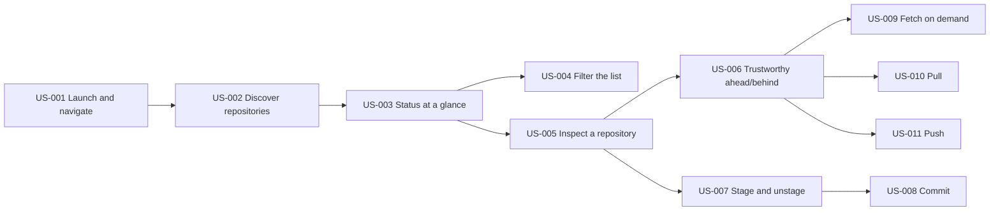

# git-station v1 Backlog

## Summary

git-station (`gs`) is a keyboard-driven TUI to discover, monitor, and manage every local git repository on the machine from one place, including everyday write operations (stage, commit, fetch, pull, push) without leaving the terminal. The backlog covers v1 only, as specified in [SPECS.md](./SPECS.md). Priorities use MoSCoW. There are 4 epics and 11 stories (10 Must, 1 Could), ordered to match the spec's milestones M1–M6. This file is also the progress tracker: every acceptance criterion is a checkbox, and the table below is the at-a-glance state.

## Status

| Story  | Title                                        | Status      |
| ------ | -------------------------------------------- | ----------- |
| US-001 | Launch gs and move between its two views     | Not started |
| US-002 | Discover every repository on the machine     | Not started |
| US-003 | See the state of each repository at a glance | Not started |
| US-004 | Filter the list by name                      | Not started |
| US-005 | Inspect one repository in detail             | Not started |
| US-006 | Trust the ahead/behind I see                 | Not started |
| US-007 | Stage and unstage files                      | Not started |
| US-008 | Commit the staged changes                    | Not started |
| US-009 | Fetch the open repository on demand          | Not started |
| US-010 | Pull from upstream                           | Not started |
| US-011 | Push to upstream                             | Not started |

Tracking rules:

- Tick a criterion only when it has been verified — by running the app, running the tests, or checking from another terminal — not when the code is merely written.
- Move a story to **In progress** when you start it, and to **Done** when every criterion is ticked.
- This is the single progress tracker; SPECS.md stays spec-only.

## Assumptions and open questions

- Assumption: single user on a single Linux machine; the persona is the developer himself (solo project, built by hand).
- Assumption: the bun + opentui scaffold already exists (dependencies pinned, lint/format configured), so there is no project-setup story; US-001 is the walking skeleton.
- Assumption: stories reference keys from the draft keyboard map in SPECS.md; key names may change during implementation without changing the stories' value.
- Assumption: criteria that say "an external `git status` / `git log` confirms" are verified from a second terminal — git itself is the oracle, since gs wraps it.
- Assumption: ahead/behind shown anywhere reflects local refs (last fetched state); only US-006 introduces network.
- Open question: the binary stays `gs` for now, but a global bun install would shadow `/usr/bin/gs` (ghostscript) — decide the final name before installing globally (SPECS.md §Known risks). Blocks no story.
- Open question: US-004 (filter) is Could — confirm whether it ships in v1 or moves to v2.

## Out of scope

Everything in SPECS.md §Non-goals: interactive rebase, stash management, submodules, pull requests / platform integrations, remote-hosted repositories, merge conflict resolution UI, applying one action to many repos at once (including fetch-all). Also out: commit history log, per-file diff, and branch checkout views (v2 candidates), and a discovery cache.

## Suggested order

Follows the spec's milestones; after each milestone the app is demonstrable.

1. **M1 Base TUI**: US-001
2. **M2 Discovery**: US-002
3. **M3 Status**: US-003, then US-004 (optional polish)
4. **M4 Detail read-only**: US-005, US-006
5. **M5 Stage + commit**: US-007, US-008
6. **M6 Network ops**: US-009, US-010, US-011

## Epic E1: See every repository at a glance

Open `gs` from any directory and read the state of every repository on the machine in one screen.

### US-001: Launch gs and move between its two views

**Epic:** E1 · **Priority:** Must · **Size:** S · **Depends on:** none

**Story**
As a developer with many local repositories, I want to launch `gs` from any directory and move between the list and the detail view with the keyboard, so that getting in and out of the tool is instant and never leaves my terminal broken.

**Acceptance criteria**

- [ ] Given a terminal open in any directory, when I run the app, then a full-screen list placeholder renders with the key hints visible.
- [ ] Given the list placeholder, when I press Enter, then the detail placeholder renders; when I then press Esc, then the list placeholder is back.
- [ ] Given any view, when I press q or Ctrl+C, then the process exits and the shell prompt returns with the terminal fully usable (no escape-code garbage).
- [ ] Given the app running, when I resize the terminal window, then the view re-renders to the new size without crashing.
- [ ] Given the project's package.json, it declares a `gs` bin entry pointing at the entry file.
- [ ] Given the repo, when I run typecheck, lint, and format check, then all three pass.

**Out of scope**

- Real repository data, discovery, and git operations.

**Notes / open questions**

- Walking skeleton: absorbs bootstrap, renderer lifecycle, view switching, and the `bin` field (SPECS.md M1). Placeholders are static text naming the view plus key hints.

### US-002: Discover every repository on the machine

**Epic:** E1 · **Priority:** Must · **Size:** M · **Depends on:** US-001

**Story**
As a developer with repositories scattered across my home directory, I want `gs` to find them all by itself when it opens, so that I never have to register repositories by hand.

**Acceptance criteria**

- [ ] Given `$HOME` contains repositories (including nested ones and at least one git worktree), when the app opens, then every one of them appears in the list, including the worktree.
- [ ] Given heavy directories (node_modules, .cache, virtualenvs) exist under `$HOME`, when the scan runs, then they are skipped.
- [ ] Given a config file declaring an extra root and an ignore entry, when the app opens, then repositories under the extra root are listed and ignored paths are not.
- [ ] Given no config file exists, when the app opens, then the scan still runs with defaults and no error is shown.
- [ ] Given a scan in progress, then a progress indicator is visible and rows appear as repositories are found.
- [ ] Given a fixture with no repositories at all, when the scan finishes, then an empty state with a hint renders instead of a blank screen.

**Notes / open questions**

- SPECS.md §Discovery (D1): prune list, config format, and `.git` as a file counting as a repository. Walker mechanics are unit-tested with temporary fixtures.

### US-003: See the state of each repository at a glance

**Epic:** E1 · **Priority:** Must · **Size:** M · **Depends on:** US-002

**Story**
As a developer scanning many repositories, I want each row to show the branch, a dirty indicator, and ahead/behind versus upstream, so that I can tell which repositories need attention without opening them.

**Acceptance criteria**

- [ ] Given a repository with a dirty working tree, 2 commits ahead and 1 behind its upstream (per local refs), when the list renders, then its row shows the name, the branch, a dirty mark, and ahead 2 / behind 1.
- [ ] Given a repository in detached HEAD, when the list renders, then the branch column shows `detached` and ahead/behind show `—`.
- [ ] Given a repository with no upstream configured, when the list renders, then ahead/behind show `—` and no error is displayed.
- [ ] Given many repositories, when statuses are still loading, then the list stays interactive and each row's status appears as soon as it is read.
- [ ] Given a repository where git itself fails, when its status cannot be read, then the row renders with an error marker and the app keeps running.
- [ ] Given the parser test suite, when run, then fixtures for porcelain v2 (branch lines, file entries, renames, detached, no upstream) all pass.

**Notes / open questions**

- SPECS.md D5: one `git status --porcelain=v2 --branch` call per repository is the single status source. Local refs only — no network in this story.

### US-004: Filter the list by name

**Epic:** E1 · **Priority:** Could · **Size:** S · **Depends on:** US-003

**Story**
As a developer with dozens of repositories, I want to narrow the list by typing part of a name, so that I can reach the repository I have in mind in a second.

**Acceptance criteria**

- [ ] Given the populated list, when I press `/` and type part of a repository name, then only matching rows remain (case-insensitive).
- [ ] Given a filter whose query matches nothing, then an explicit no-matches state renders instead of a blank screen.
- [ ] Given an active filter, when I clear the query, then the full list returns.
- [ ] Given an active filter with results, when I press Enter, then the detail opens for the selected result.

**Notes / open questions**

- Priority is Could — confirm whether it ships in v1 or moves to v2.

## Epic E2: Inspect a repository's true state

Drill into one repository and trust what the screen shows.

### US-005: Inspect one repository in detail

**Epic:** E2 · **Priority:** Must · **Size:** S · **Depends on:** US-003

**Story**
As a developer about to act on a repository, I want to open it and see its path, branch, upstream, ahead/behind, and every pending file, so that I understand its exact state before doing anything.

**Acceptance criteria**

- [ ] Given a repository selected in the list, when I press Enter, then the detail shows its absolute path, branch, upstream name, ahead/behind, and counts of staged, unstaged, and untracked files.
- [ ] Given a repository with staged, unstaged, and untracked changes, when the detail renders, then the files appear grouped as staged / unstaged / untracked, and a renamed file displays as `old -> new`.
- [ ] Given a clean repository, when the detail renders, then a clean-state message shows instead of empty groups.
- [ ] Given a repository in detached HEAD, when the detail renders, then the header shows `detached` without crashing.
- [ ] Given the detail view, when I press Esc, then the list returns with the previous selection preserved.

### US-006: Trust the ahead/behind I see

**Epic:** E2 · **Priority:** Must · **Size:** S · **Depends on:** US-005

**Story**
As a developer deciding whether to pull or push, I want the detail view to refresh upstream state in the background when I open it, so that the ahead/behind I see reflects the real remote and not stale local refs.

**Acceptance criteria**

- [ ] Given a repository whose remote has commits missing from local refs, when I open its detail, then a fetching indicator shows and, when the fetch completes, ahead/behind update to the true values.
- [ ] Given the detail view while a fetch is running, when I press keys, then the view stays responsive.
- [ ] Given an unreachable remote (network down or bad URL), when the fetch fails, then the error appears in the feedback line and the local state remains visible.
- [ ] Given a fetch that completes with no changes, when it finishes, then the indicator clears and no stale "fetching" state is left behind.

**Notes / open questions**

- SPECS.md D4: this is the only implicit network in v1; there is no fetch-all.

## Epic E3: Record my changes

Prepare and commit changes without leaving `gs`.

### US-007: Stage and unstage files

**Epic:** E3 · **Priority:** Must · **Size:** S · **Depends on:** US-005

**Story**
As a developer preparing a commit, I want to pick which changes go into it directly from the detail view, so that I never drop to a shell just to stage a file.

**Acceptance criteria**

- [ ] Given an unstaged or untracked file selected in the detail, when I press the stage key, then the file moves to the staged group and an external `git status` confirms it is staged.
- [ ] Given a staged file selected, when I press the stage key, then it returns to unstaged or untracked and an external `git status` confirms it.
- [ ] Given pending changes, when I press the stage-all key, then every pending file moves to the staged group.
- [ ] Given a clean working tree, when I press the stage-all key, then nothing is staged and a message says there is nothing to stage.
- [ ] Given a staging action that fails (for example, the path no longer exists), when it errors, then the message shows in the feedback line and the displayed groups still match reality.

**Notes / open questions**

- Unstage mechanics per SPECS.md §Git command map (tracked vs untracked files take different commands).

### US-008: Commit the staged changes

**Epic:** E3 · **Priority:** Must · **Size:** S · **Depends on:** US-007

**Story**
As a developer with staged changes, I want to write a message and commit from the detail view, so that a change is recorded without leaving `gs`.

**Acceptance criteria**

- [ ] Given staged changes, when I open the commit input, type a one-line message, and press Enter, then the commit exists (an external `git log -1` shows it) and the file groups refresh.
- [ ] Given the commit input open, when I press Esc, then the input closes and no commit is created.
- [ ] Given nothing staged, when I confirm a commit, then git's error shows inline and no commit is created.
- [ ] Given an empty message, when I press Enter, then no commit is created and a hint or git's error shows.

**Notes / open questions**

- Single-line input per SPECS.md D3; a multi-line editor is a v2 candidate.

## Epic E4: Stay in sync with the remote

Move commits between local and upstream from the TUI.

### US-009: Fetch the open repository on demand

**Epic:** E4 · **Priority:** Must · **Size:** S · **Depends on:** US-006

**Story**
As a developer who suspects the remote moved, I want to fetch the repository I'm inspecting at will, so that I can refresh upstream state without reopening the detail view.

**Acceptance criteria**

- [ ] Given the detail view, when I press the fetch key, then a running indicator shows and, on completion, ahead/behind refresh.
- [ ] Given a fetch already running for this repository, when I press the fetch key again, then the second press is ignored (no concurrent fetch).
- [ ] Given a fetch that fails, when it errors, then its stderr shows in the feedback line and the app keeps running.

### US-010: Pull from upstream

**Epic:** E4 · **Priority:** Must · **Size:** S · **Depends on:** US-006

**Story**
As a developer with a repository behind its upstream, I want to pull from the detail view, so that it catches up without me `cd`-ing to it.

**Acceptance criteria**

- [ ] Given a clean repository behind its upstream, when I press the pull key, then a running indicator shows and, on completion, the detail shows zero behind (an external `git log` contains the new commits).
- [ ] Given an operation already running, when I press the pull key, then it is ignored until the running operation finishes.
- [ ] Given a pull that ends in merge conflicts, when it finishes, then the conflicting files appear in the file list and the pull output shows inline; resolving conflicts is out of scope.
- [ ] Given a repository with no upstream, when I press the pull key, then git's error shows inline and nothing else changes.

### US-011: Push to upstream

**Epic:** E4 · **Priority:** Must · **Size:** S · **Depends on:** US-006

**Story**
As a developer with local commits ready, I want to push from the detail view, so that they reach the remote without leaving `gs`.

**Acceptance criteria**

- [ ] Given a repository ahead of its upstream, when I press the push key, then a running indicator shows and, on completion, ahead shows zero (an external check finds no commits left ahead of `@{upstream}`).
- [ ] Given a push rejected by the remote (stale refs or no permission), when it fails, then git's stderr shows inline and the app keeps running.
- [ ] Given a repository with no upstream, when I press the push key, then git's error shows inline.
- [ ] Given an operation already running, when I press the push key, then it is ignored until it finishes.

## INVEST check

| Story  | I   | N   | V   | E   | S   | T   | Adjustments made                                                      |
| ------ | --- | --- | --- | --- | --- | --- | --------------------------------------------------------------------- |
| US-001 | ✔   | ✔   | ✔   | ✔   | ✔   | ✔   | Absorbed bootstrap and `bin` entry as the walking skeleton            |
| US-002 | ✔   | ✔   | ✔   | ✔   | ✔   | ✔   | none                                                                  |
| US-003 | ✔   | ✔   | ✔   | ✔   | ✔   | ✔   | Split row status (list) from file detail (US-005)                     |
| US-004 | ✔   | ✔   | ✔   | ✔   | ✔   | ✔   | Kept as Could pending v1/v2 confirmation                              |
| US-005 | ✔   | ✔   | ✔   | ✔   | ✔   | ✔   | Read-only inspection split from staging                               |
| US-006 | ✔   | ✔   | ✔   | ✔   | ✔   | ✔   | Implicit fetch-on-open split from on-demand fetch                     |
| US-007 | ✔   | ✔   | ✔   | ✔   | ✔   | ✔   | Stage/unstage kept as one toggle capability                           |
| US-008 | ✔   | ✔   | ✔   | ✔   | ✔   | ✔   | Commit separated from staging; dependency made explicit               |
| US-009 | ✔   | ✔   | ✔   | ✔   | ✔   | ✔   | Interface-variation split of fetch (on demand)                        |
| US-010 | ✔   | ✔   | ✔   | ✔   | ✔   | ✔   | Operation split; conflict handling bounded to "visible, not resolved" |
| US-011 | ✔   | ✔   | ✔   | ✔   | ✔   | ✔   | Operation split                                                       |
