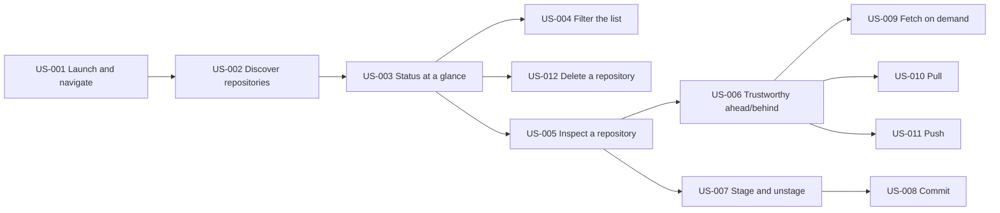

# git-station v1 Backlog

## Summary

git-station (`gs`) is a keyboard-driven TUI to discover, monitor, and manage every local git repository on the machine from one place, including everyday write operations (stage, commit, fetch, pull, push) without leaving the terminal. The backlog covers v1 only, as specified in [SPECS.md](../SPECS.md). Priorities use MoSCoW. There are 5 epics and 12 stories (11 Must, 1 Could), ordered to match the spec's milestones M1–M7. This directory is the progress tracker: every acceptance criterion is a checkbox in its story file, and the table below is the at-a-glance state.

## Status

| Story   | Title                                        | Status      | File                                             |
| ------- | -------------------------------------------- | ----------- | ------------------------------------------------ |
| US-001  | Launch gs and move between its two views     | Done        | [US-001.md](./US-001.md)                         |
| US-002  | Discover every repository on the machine     | Done        | [US-002.md](./US-002.md)                         |
| IMP-001 | Simplify the directory walk in src/repo.ts   | Done        | [improvements.md](./improvements.md)             |
| IMP-002 | Ship a Linux binary with a one-line install  | Not started | [improvements.md](./improvements.md)             |
| IMP-004 | Tighten the status naming and path reading   | Done        | [improvements.md](./improvements.md)             |
| IMP-005 | Compute the detail view only when it opens   | Done        | [improvements.md](./improvements.md)             |
| IMP-006 | Componentize the UI layer                    | Done        | [improvements.md](./improvements.md)             |
| IMP-007 | Theme and component styling                  | In progress | [improvements.md](./improvements.md)             |
| IMP-008 | Declare the table columns once               | Done        | [improvements.md](./improvements.md)             |
| IMP-009 | Confirm the search with Enter before moving  | Done        | [improvements.md](./improvements.md)             |
| IMP-010 | Wire the full action catalog                 | Not started | [improvements.md](./improvements.md)             |
| IMP-011 | Simplify the keyboard handling in App        | Not started | [improvements.md](./improvements.md)             |
| US-003  | See the state of each repository at a glance | Done        | [US-003.md](./US-003.md)                         |
| US-004  | Filter the list by name                      | Done        | [US-004.md](./US-004.md)                         |
| US-005  | Inspect one repository in detail             | Done        | [US-005.md](./US-005.md)                         |
| US-006  | Trust the ahead/behind I see                 | Not started | [US-006.md](./US-006.md)                         |
| US-007  | Stage and unstage files                      | Not started | [US-007.md](./US-007.md)                         |
| US-008  | Commit the staged changes                    | Not started | [US-008.md](./US-008.md)                         |
| US-009  | Fetch the open repository on demand          | Not started | [US-009.md](./US-009.md)                         |
| US-010  | Pull from upstream                           | Not started | [US-010.md](./US-010.md)                         |
| US-011  | Push to upstream                             | Not started | [US-011.md](./US-011.md)                         |
| US-012  | Delete a repository from the list            | Not started | [US-012.md](./US-012.md)                         |
| US-013  | View the commit graph                        | Not started | [US-013.md](./US-013.md)                         |

Tracking rules:

- Tick a step only when it has been verified — by running the app, running the tests, or checking from another terminal — not when the code is merely written. A step marked `eye` counts as verified when the user says he looked at it and it is right.
- Move a story to **In progress** when you start it, and to **Done** when every criterion is ticked.
- The unit of work is the next unticked step. If a criterion is too big for one sitting (more than one thing to check at the end), the agent splits it into indented sub-steps right under it, writing them into the story's file at that moment. Once written they are the plan: a later conversation uses them as they are and never splits the same criterion again, unless the user asks or the scope changes. Each sub-step is ticked on its own, and the parent criterion is ticked when all its sub-steps are.
- Each step being worked on carries a `Verified by:` line: a test file with test names and `planned` or `written`, or `eye` for what the screen shows. The line is added when the step is planned, not for the whole backlog in advance. A step that already has the line never gets new tests proposed; `planned` means the tests are still to be written.
- When the last step of a story is done, the agent writes `Closing questions: pending` under the story's heading. It becomes `done` once the user has answered the explanation and chosen from the proposals (or said none).
- At the end of a story the agent offers a numbered list of proposals (names, refactors, automations). The ones the user picks are added to the backlog as improvements: `IMP-001`, `IMP-002`… They appear in the Status table above and in [improvements.md](./improvements.md), with the same checkboxes, sub-steps and `Verified by` lines as stories, and they go before the next story's first step unless the user says otherwise.
- This directory is the single progress tracker: the Status table here is the at-a-glance state, each story lives in its own file, and improvements live in `improvements.md`. New stories and improvements get a new file and a row here. SPECS.md stays spec-only.

## Assumptions and open questions

- Assumption: single user on a single Linux machine; the persona is the developer himself (solo project, built by hand).
- Assumption: the bun + opentui scaffold already exists (dependencies pinned, lint/format configured), so there is no project-setup story; US-001 is the walking skeleton.
- Assumption: stories reference keys from the draft keyboard map in SPECS.md; key names may change during implementation without changing the stories' value.
- Assumption: criteria that say "an external `git status` / `git log` confirms" are verified from a second terminal — git itself is the oracle, since gs wraps it.
- Assumption: ahead/behind shown anywhere reflects local refs (last fetched state); only US-006 introduces network.
- Resolved: the binary will be named `git-station`, not `gs` — the ghostscript collision on `/usr/bin/gs` is avoided entirely. The `bin` entry in package.json should use that name.
- Resolved (2026-11-15): US-004 (filter) ships in v1 — the user confirmed it stays. Priority in the backlog stays Could, but it is done before US-006.

## Out of scope

Everything in SPECS.md §Non-goals: interactive rebase, stash management, submodules, pull requests / platform integrations, remote-hosted repositories, merge conflict resolution UI, applying one action to many repos at once (including fetch-all). Also out: commit history log, per-file diff, and branch checkout views (v2 candidates), and a discovery cache.

## Suggested order

Follows the spec's milestones; after each milestone the app is demonstrable.

1. **M1 Base TUI**: US-001
2. **M2 Discovery**: US-002
3. **M3 Status**: US-003, then US-004 (optional polish)
4. **M7 Delete**: US-012 (needs only the interactive list; place after M3)
5. **M4 Detail read-only**: US-005, US-006
6. **M5 Stage + commit**: US-007, US-008
7. **M6 Network ops**: US-009, US-010, US-011

## INVEST check

| Story  | I   | N   | V   | E   | S   | T   | Adjustments made                                                         |
| ------ | --- | --- | --- | --- | --- | --- | ------------------------------------------------------------------------ |
| US-001 | ✔   | ✔   | ✔   | ✔   | ✔   | ✔   | Absorbed bootstrap and `bin` entry as the walking skeleton               |
| US-002 | ✔   | ✔   | ✔   | ✔   | ✔   | ✔   | none                                                                     |
| US-003 | ✔   | ✔   | ✔   | ✔   | ✔   | ✔   | Split row status (list) from file detail (US-005)                        |
| US-004 | ✔   | ✔   | ✔   | ✔   | ✔   | ✔   | Could priority, confirmed to ship in v1 (2026-11-15)                     |
| US-005 | ✔   | ✔   | ✔   | ✔   | ✔   | ✔   | Read-only inspection split from staging                                  |
| US-006 | ✔   | ✔   | ✔   | ✔   | ✔   | ✔   | Implicit fetch-on-open split from on-demand fetch                        |
| US-007 | ✔   | ✔   | ✔   | ✔   | ✔   | ✔   | Stage/unstage kept as one toggle capability                              |
| US-008 | ✔   | ✔   | ✔   | ✔   | ✔   | ✔   | Commit separated from staging; dependency made explicit                  |
| US-009 | ✔   | ✔   | ✔   | ✔   | ✔   | ✔   | Interface-variation split of fetch (on demand)                           |
| US-010 | ✔   | ✔   | ✔   | ✔   | ✔   | ✔   | Operation split; conflict handling bounded to "visible, not resolved"    |
| US-011 | ✔   | ✔   | ✔   | ✔   | ✔   | ✔   | Operation split                                                          |
| US-012 | ✔   | ✔   | ✔   | ✔   | ✔   | ✔   | Typed-name confirmation and set-wide dirty check absorbed into the story |
